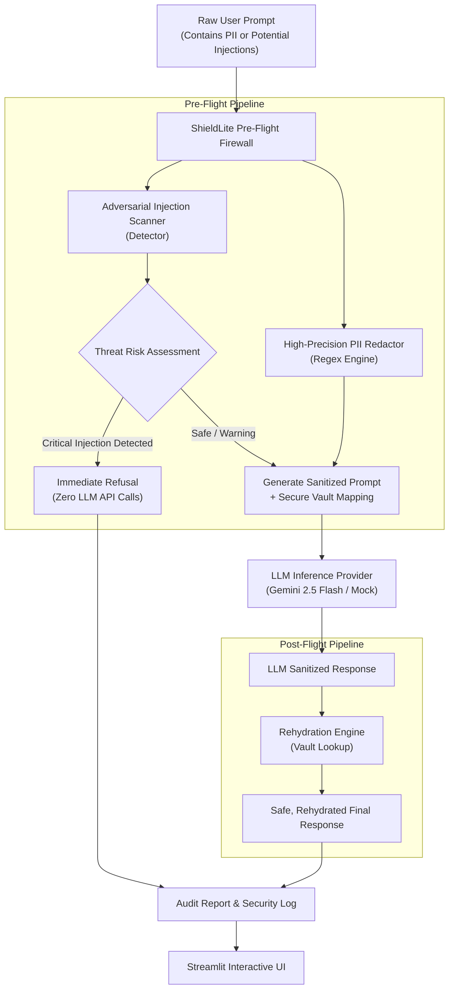

# 🛡️ ShieldLite: Pre-Flight & Post-Flight LLM Safety Guardrail

[](https://www.python.org/downloads/)
[](https://docs.pydantic.dev/)
[](https://streamlit.io/)
[](https://pytest.org/)
[](LICENSE)

> **A high-performance pre-flight and post-flight guardrail middleware for LLM applications. Automatically redacts personal identifying information (PII), intercepts adversarial prompt injections and jailbreaks before model invocation, and securely rehydrates outputs.**

---

## 📌 Overview & Core Problem

Directly exposing Large Language Models to untrusted user input introduces two critical failure modes in production systems:

1. **Data Privacy & Compliance Violations (GDPR / HIPAA):** Transmitting raw user prompts containing credit cards, social security numbers, or internal API tokens to third-party model providers violates data residency laws.
2. **Adversarial Injections & System Prompt Exfiltration:** Malicious users attempt instruction overrides (*"Ignore all previous directives"*), persona hijacks (*"DAN mode"*), or template delimiter injection to bypass alignment and steal proprietary prompts.

**ShieldLite** acts as a deterministic defense-in-depth firewall around your LLM:
* **Pre-Flight Inspection:** Scans for adversarial signatures and masks sensitive PII entities into synthetic placeholders (`[EMAIL_1]`, `[SSN_1]`). High-risk attacks are blocked **before** touching the LLM API, eliminating cost and exposure.
* **Safe Inference:** The model processes clean, sanitized tokens.
* **Post-Flight Rehydration:** Safely maps placeholders back to original values in the final response.

---

## 🏗️ System Architecture



---

## ⚡ Key Engineering Features

| Component | Technical Implementation | Security & Reliability Value |
| :--- | :--- | :--- |
| **Multi-Entity PII Redactor** | Pre-compiled regex patterns for Emails, US SSNs, Credit Cards, Phones, IPv4, and API Keys. | Prevents sensitive data leakage to external LLM providers. |
| **Bidirectional Vault** | In-memory token vault mapping synthetic placeholders (`[CARD_1]`) to raw values with entity deduplication. | Preserves conversational context while maintaining zero plain-text PII in LLM context windows. |
| **Adversarial Injection Scanner** | Signature matcher detecting instruction overrides, jailbreak personas (DAN), system prompt leakage, and delimiters. | Intercepts attacks before model execution, protecting system instructions and preventing unauthorized actions. |
| **Deterministic Blocking** | Immediately halts execution on critical threats ($0.95$ risk score) with standard refusal payloads. | Saves inference API costs on attack traffic and guarantees zero jailbreak exposure. |
| **Zero-Crash Mock Provider** | Offline mock engine simulating realistic sanitized prompt execution. | Enables full local testing and CI/CD without API keys or external network dependencies. |

---

## 🚀 Quickstart Guide

### 1. Clone & Set Up Virtual Environment
```bash
git clone https://github.com/afsalkp007/shield-lite.git
cd shield-lite

# Create and activate virtual environment
python3 -m venv .venv
source .venv/bin/activate

# Install dependencies
pip install -r requirements.txt
```

### 2. Configure Environment (Optional for Live Gemini API)
```bash
cp .env.example .env
# Paste your GEMINI_API_KEY if desired.
# If omitted, ShieldLite runs in offline mock mode.
```

---

## 🌐 Interactive Streamlit Web Application

Launch the real-time guardrail playground:
```bash
streamlit run shield_lite/app.py
```

* **Live Dataflow Inspection:** View Raw Input vs Sanitized Prompt vs Final Output side-by-side.
* **Scenario Presets:** Instant 1-click loading of credit card refunds, DAN mode jailbreaks, system prompt exfiltration, and devops API key leaks.
* **Interactive Vault Drawer:** Inspect detected entities, character offsets, and matched regex patterns.
* **Audit Trail Export:** Download complete JSON audit reports for compliance logging.

---

## 🧪 Test Suite

Run the full automated test suite (16 unit tests covering Pydantic models, PII detection, rehydration, injection detection, and end-to-end pipeline execution):
```bash
pytest -v
```

```text
======================== 16 passed in 0.10s =========================
```

---

## 📂 Repository Structure

```text
shield-lite/
├── .env.example              # Environment variables template
├── .gitignore                # Git ignore rules (secrets, venv, caches)
├── LICENSE                   # MIT License
├── README.md                 # Technical documentation
├── pyproject.toml            # Project packaging specification
├── requirements.txt          # Python dependencies
├── shield_lite/              # Core application package
│   ├── __init__.py           # Package version definition
│   ├── app.py                # Streamlit interactive playground
│   ├── detector.py           # Prompt injection and jailbreak scanner
│   ├── guard.py              # Pre-flight and post-flight orchestrator
│   ├── models.py             # Pydantic v2 schemas and threat models
│   ├── providers.py          # LLM inference provider & mock fallback
│   └── redactor.py           # Regex PII detection & rehydration engine
└── tests/                    # Automated test suite (16/16 passed)
    ├── test_detector.py
    ├── test_guard.py
    ├── test_models.py
    └── test_redactor.py
```

---

## 👤 Author & License

* **Author:** Afsal ([afsalkp.mohammed@gmail.com](mailto:afsalkp.mohammed@gmail.com))
* **License:** [MIT License](LICENSE)
